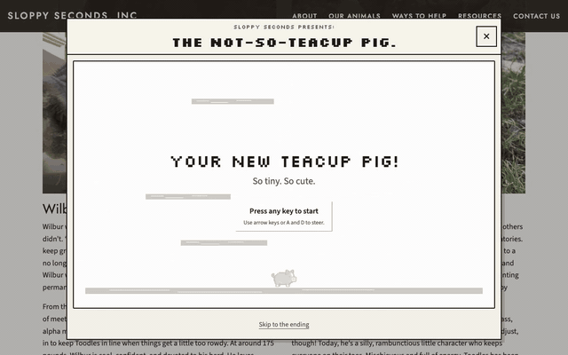

# The Not-So-Teacup Pig

A redesign of Sloppy Seconds' "Our Animals" page, built around a short game. Wilbur was sold as a "teacup" piglet and
grew to about 175 pounds. In the game he keeps growing until he breaks the page, then lands on it and stays.

**Live:** [sloppy-seconds.vercel.app](https://sloppy-seconds.vercel.app/)



## What happens

- **The climb.** Wilbur bounces on his own and you steer with the arrow keys, A and D, or by holding either side of
  the screen. His age stands in for a score. Progress counts height or time, whichever comes first, so everyone
  reaches the ending.
- **The page strains.** As he gets heavier, his landings shake the window, crack its edges, tilt the photos, and
  knock letters out of the headings.
- **The breakthrough.** He falls through the window onto the real page. The ending asks the visitor to help.
- **The pasture.** Afterwards he lives in a lane at the bottom of the page. He wanders, naps, roots around, and digs
  up stickers for the Field Guide. Progress is saved in the browser, so he is still there after a refresh.

## How it works

| Piece                                                      | Where                                    |
| ---------------------------------------------------------- | ---------------------------------------- |
| Physics: a hand-rolled vertical jumper, mutated in place   | `src/game/physics/`                      |
| Game loop: `requestAnimationFrame`, writes DOM transforms  | `src/game/PigJumpGame/`                  |
| Growth, ages, and strain tiers                             | `src/game/progression/age.ts`            |
| Page reactions (shakes, cracks, loose letters), with GSAP  | `src/page/reactions.ts`                  |
| The breakthrough and landing timeline                      | `src/animations/`                        |
| Pasture pig: a weighted state machine                      | `src/npc/behaviorMachine/`               |
| Saved progress (`localStorage`, tolerant of old or junk data) | `src/progress/storage.ts`             |

Some choices worth knowing:

- **Physics stays off React.** The world object is mutated each frame and copied onto transforms. React re-renders
  only when a plank's crack state changes. GSAP never moves anything physics owns. It only choreographs what happens
  after physics stops.
- **The playfield never crops.** The physics needs at least 220px of height for a full jump arc. A shorter stage, such
  as a phone on its side, draws the same world scaled down instead of hiding its floor.
- **One native `<dialog>`** holds both the game and the Field Guide. Focus moves in, returns to the button that opened
  it, and the page behind it is inert.
- **Reduced motion** keeps the whole story but skips the shakes and simplifies the fall. The game also pauses while
  the tab is hidden.

## Run it

```sh
npm install
npm run dev
```

| Script                         | Does                                                          |
| ------------------------------ | ------------------------------------------------------------- |
| `npm run build`                | Type-checks and builds to `dist/`                             |
| `npm test`                     | Unit tests (Vitest): physics, progression, the pig, storage   |
| `npm run e2e`                  | Playwright journey tests on a desktop, a phone, and a landscape phone |
| `npm run lint`                 | ESLint                                                        |
| `npm run format` / `format:check` | Prettier                                                   |

Run `npx playwright install chromium` once before the first `npm run e2e`. CI runs all of the above on every push
and pull request.

Built with React 19, TypeScript, Vite, and GSAP.
